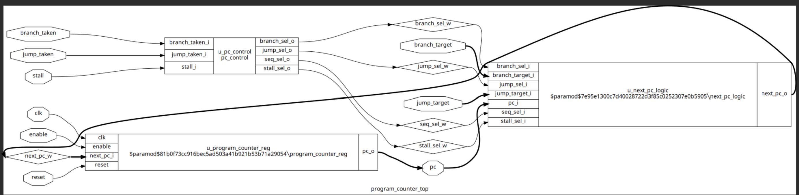
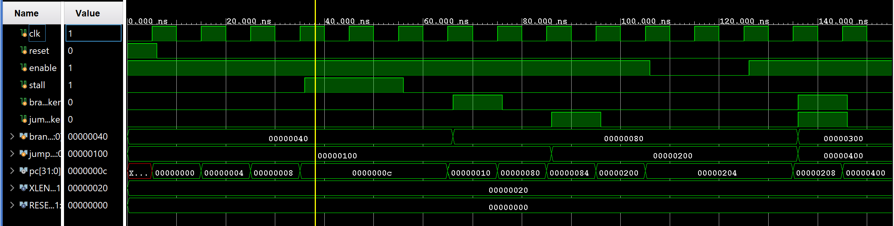
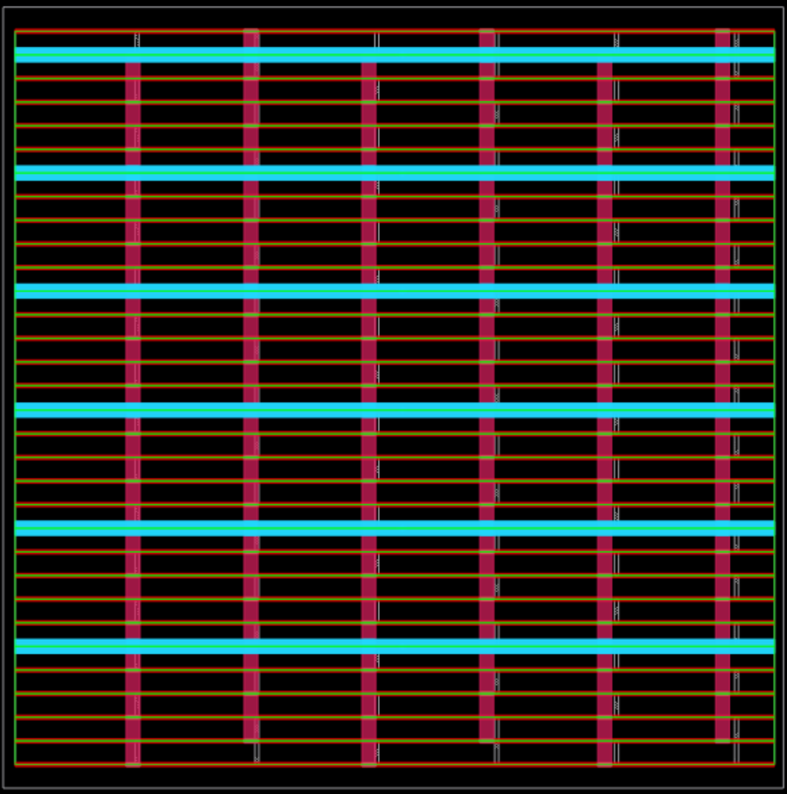
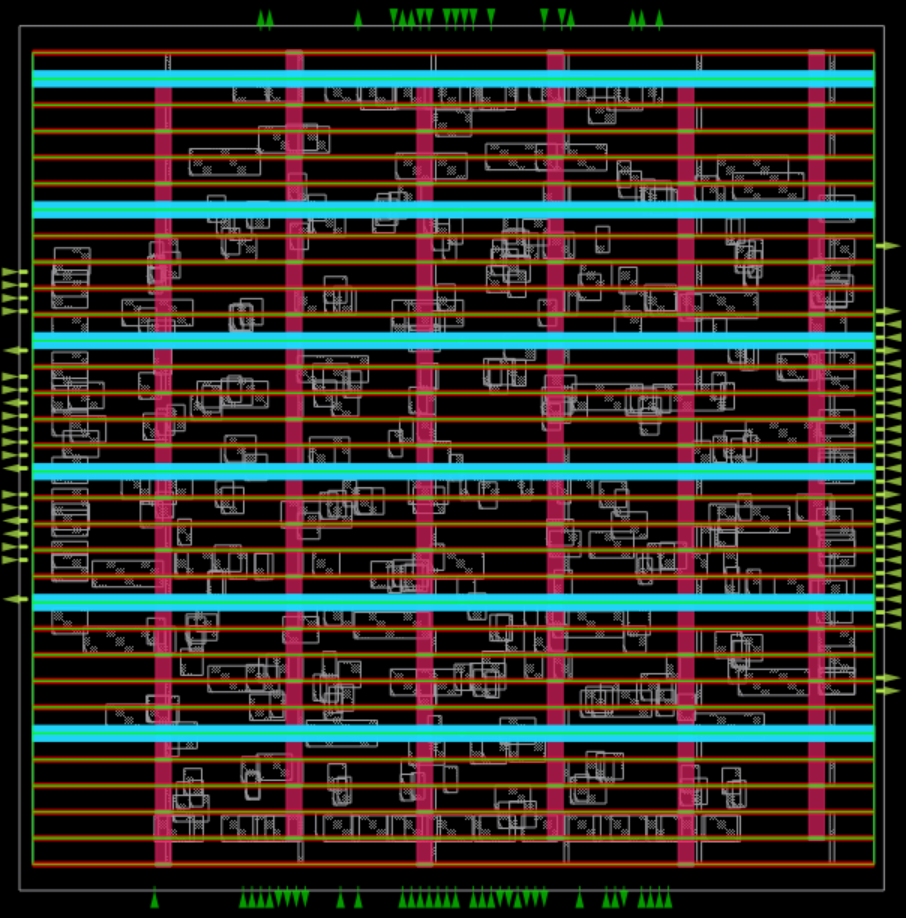
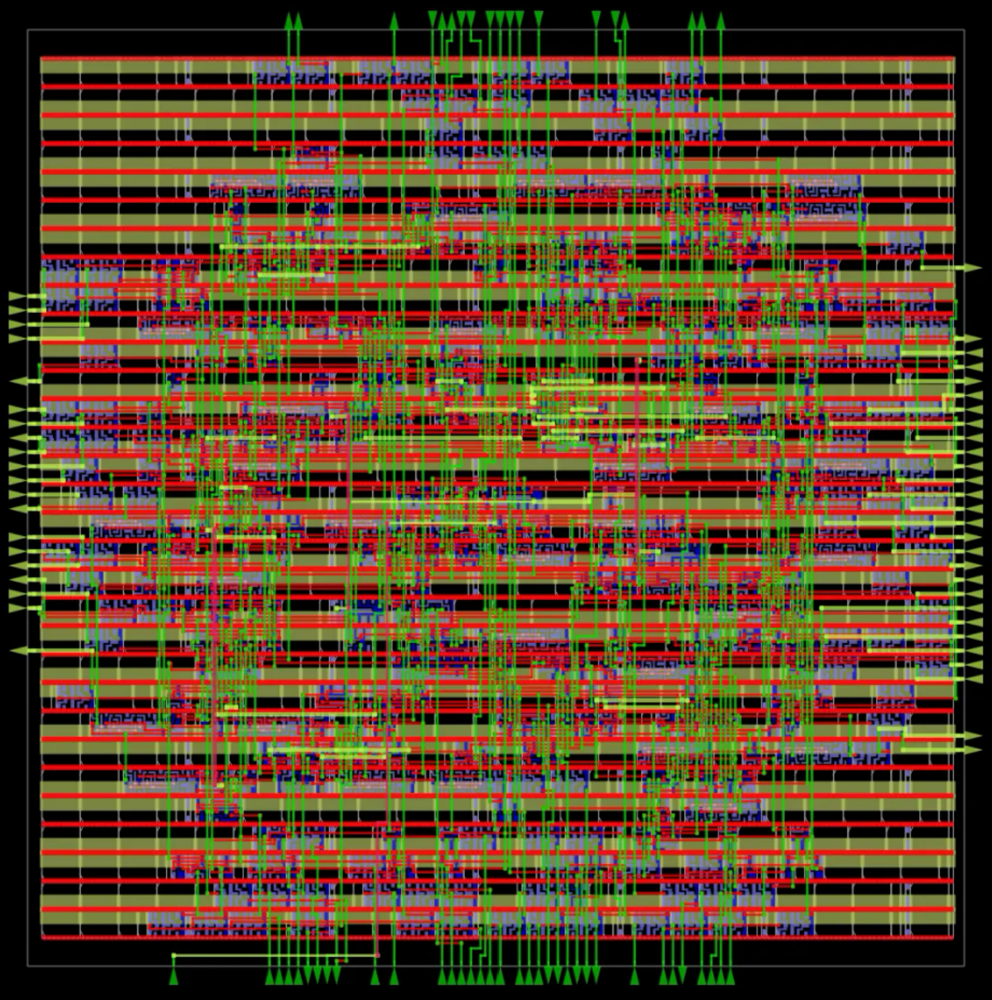
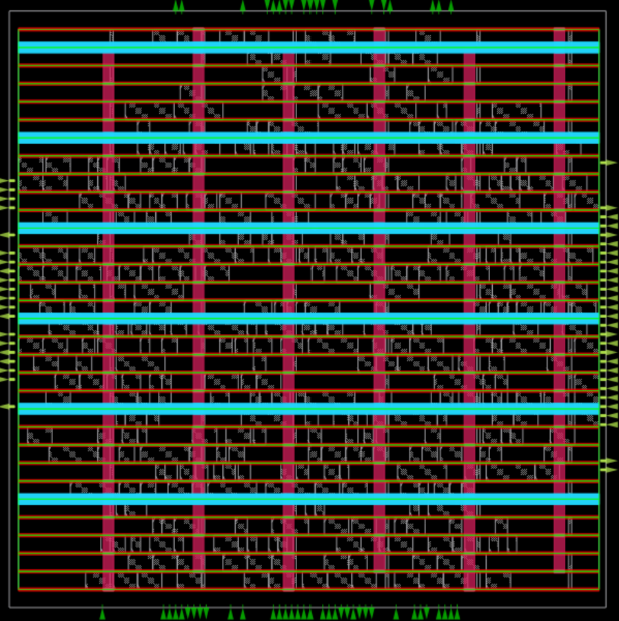
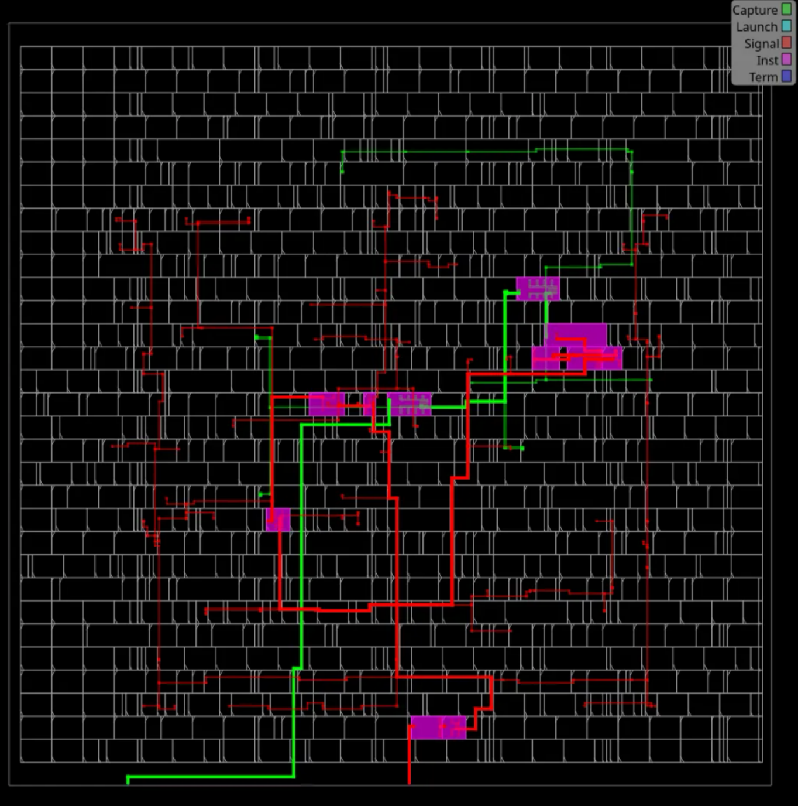
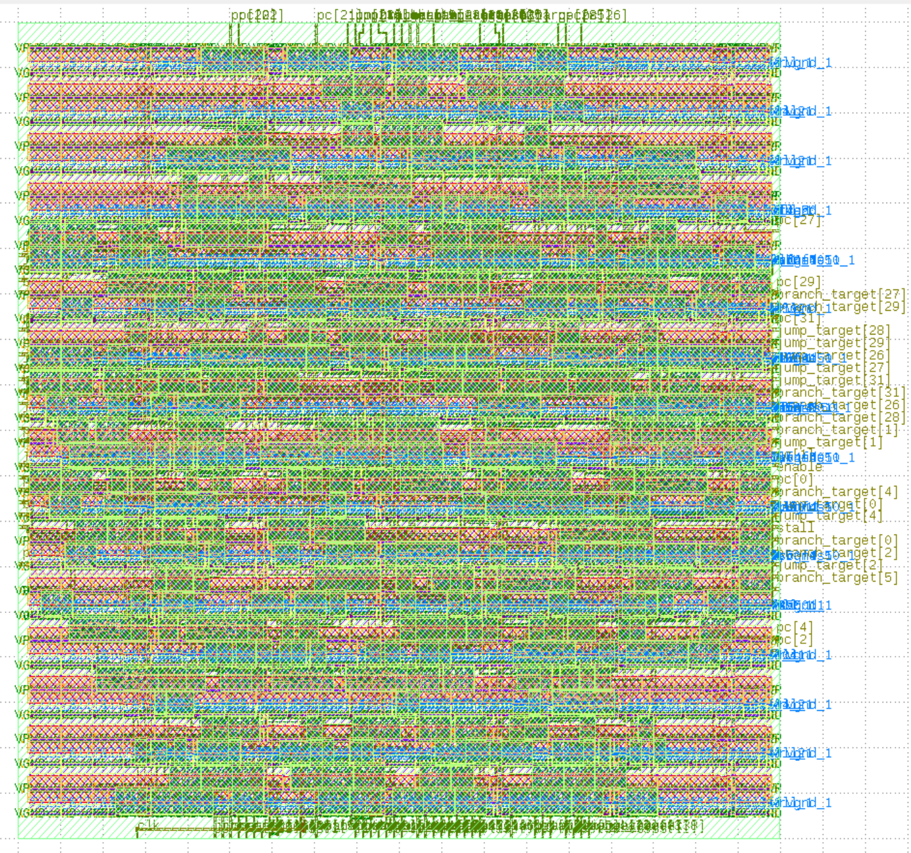

# Implementation, Physical Design, and PPA Optimization of a 32-bit Program Counter Through the RTL-to-GDSII ASIC Design Flow Using SKY130

A 32-bit Program Counter taken through the complete open-source RTL-to-GDSII flow (Yosys, OpenROAD / ORFS, OpenSTA) on the SkyWater SKY130HD library, with stage-by-stage timing, power and area results.

Done as an in-person NPTEL Summer Internship project (IIT Madras programme) at the Department of ECE, **IIT Roorkee**, under Prof. Sudeb Dasgupta (1 July – 10 August 2026).

| Attribute | Value |
|---|---|
| Design | 32-bit Program Counter (`program_counter_top`, 4 Verilog modules) |
| RTL language | Verilog HDL, modular (control logic, next-PC computation, register storage) |
| Synthesis | Yosys (via ORFS) |
| Physical design | OpenROAD / OpenROAD Flow Scripts |
| Timing analysis | OpenSTA |
| Parasitics | OpenRCX |
| Layout viewers | OpenROAD GUI, KLayout, Magic |
| Platform | SkyWater SKY130HD (`sky130_fd_sc_hd`) |
| Ports | 9 (102 port bits) |
| OS | Ubuntu 24.04 LTS |

## Contents
1. [Architecture](#architecture) 2. [Functional verification](#functional-verification) 3. [Results](#results) 4. [Layout images](#layout-images) 5. [Reproduction](#reproduction) 6. [Limitations](#limitations) 7. [Repository structure](#repository-structure)

## Architecture
Three modules under `program_counter_top`: a priority decoder (`pc_control`), the next-PC incrementer and mux (`next_pc_logic`) and the 32-bit register (`program_counter_reg`). Priority is jump, then branch, then stall, then +4; synchronous reset overrides enable. Block diagram, interface and details: [docs/architecture.md](docs/architecture.md).


*RTL-level schematic after elaboration, showing the multiplexers, incrementer and PC register.*

## Functional verification

*Simulation waveform covering reset, increment by 4, stall, enable low, branch and jump.*

The original self-checking testbench is in `verification/testbenches/`. Run with Icarus Verilog 12.0: compiled with no warnings and all 15 checks passed ([log](verification/simulation_results/iverilog_run.log)). Gaps in coverage are listed in [verification/README.md](verification/README.md). Run it yourself with `sh scripts/run_sim.sh`.

## Results
Synthesis: 331 cells, 2313.47 µm², structural check passed with 0 problems.

| Stage | WNS (ns) | Worst slack (ns) | Fmax (MHz) | Total power (µW) |
|---|---|---|---|---|
| Floorplan | 0.00 | 8.08 | 521.89 | 183 |
| Placement (after resizing) | 0.00 | 7.34 | 376.20 | 238 |
| Clock tree synthesis | 0.00 | 7.54 | 405.85 | 339 |
| Routing | 0.00 | 7.36 | 378.47 | 355 |
| Final GDSII | 0.00 (TNS 0.00) | not reported | 400.40 | 336 |

Final sign-off: 0 setup violations, 0 hold violations, DRC passed, critical path 2.57 ns. Routing: 8392 µm total wire length, 2820 vias. Full tables and caveats: [docs/ppa_results.md](docs/ppa_results.md).

Power values are tool estimates, not silicon measurements.

## Layout images
| Floorplan | Placement | Routed layout |
|---|---|---|
|  |  |  |

| Clock tree | Critical path | Final GDSII (KLayout) |
|---|---|---|
|  |  |  |

More figures: congestion map and IR drop in `images/routing/`, clock tree hierarchy in `images/clock_tree_synthesis/`. Descriptions are in [docs/source_manifest.md](docs/source_manifest.md).

## Reproduction
See [docs/rtl_to_gdsii_flow.md](docs/rtl_to_gdsii_flow.md). The standard ORFS pattern is `make DESIGN_CONFIG=./designs/sky130hd/<design_name>/config.mk` from `OpenROAD-flow-scripts/flow`. The RTL is in `rtl/`; the `config.mk` and SDC still need to be added.

## Limitations
- `config.mk` and the SDC are not in the repository yet.
- Simulation is RTL-level only, and the testbench does not cover every control combination.
- Results come from the internship report and slides, not from raw ORFS reports.
- Clock period is inferred (see PPA doc); confirm it from the SDC.
- No power breakdown (internal/switching/leakage) for this design is available.
- Final placed/CTS cell counts and utilization were not reported for this design.
- Not claimed: tape-out readiness, silicon validation, or formal verification.

## Repository structure
```
README.md
rtl/                 original Verilog, unmodified, with checksums
verification/        original testbench and simulation log
scripts/             run_sim.sh
images/              figures extracted at original resolution from the slides
docs/                architecture, flow, PPA results, source manifest
results/ppa_summary.csv
```

## Acknowledgements
Prof. Sudeb Dasgupta (IIT Roorkee), the NPTEL Summer Internship Programme (IIT Madras), and the ECE faculty and research scholars at IIT Roorkee for EDA tool and compute support.

## References
OpenROAD Flow Scripts: https://github.com/The-OpenROAD-Project/OpenROAD-flow-scripts · Yosys: https://yosyshq.net/yosys/ · OpenSTA: https://github.com/The-OpenROAD-Project/OpenSTA
