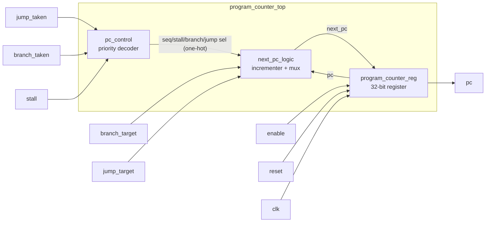

# Architecture

Everything here is read from the RTL in `rtl/`. Top module: `program_counter_top` (parameters `XLEN = 32`, `RESET_VECTOR = 32'h0000_0000`, `PC_INCREMENT = 32'd4`).

## Modules
| File | Module | Role |
|---|---|---|
| `program_counter_top.v` | `program_counter_top` | wires the three submodules together |
| `pc_control.v` | `pc_control` | turns jump/branch/stall into four one-hot selects |
| `next_pc_logic.v` | `next_pc_logic` | computes `pc + PC_INCREMENT` and selects the next PC |
| `program_counter_reg.v` | `program_counter_reg` | stores the PC, synchronous active-high reset, enable |

## Interface of `program_counter_top` (9 ports, 102 bits)
| Signal | Dir | Width | Purpose |
|---|---|---|---|
| clk | in | 1 | clock (rising edge) |
| reset | in | 1 | synchronous, active high; loads `RESET_VECTOR` |
| enable | in | 1 | low holds the PC |
| stall | in | 1 | holds the PC unless jump or branch is asserted |
| branch_taken | in | 1 | select `branch_target` |
| jump_taken | in | 1 | select `jump_target` |
| branch_target | in | XLEN | branch address |
| jump_target | in | XLEN | jump address |
| pc | out | XLEN | current program counter |

## Behaviour and priority
Next-PC priority, highest first (in `pc_control` and `next_pc_logic`):
1. jump → `jump_target`
2. branch → `branch_target`
3. stall → hold current PC
4. otherwise → `pc + PC_INCREMENT` (+4)

At the register: `reset` overrides `enable`; with `enable` low the PC is retained. So a stall does not block a jump or branch, but `enable = 0` blocks everything except reset.

The next-PC logic holds one incrementer and one multiplexer and has no sequential logic; the register module has no combinational logic.

## Note on file headers
The RTL headers are kept exactly as written and still say "Version 2.0" and refer to an earlier version. They were not edited, per the preservation requirement.
